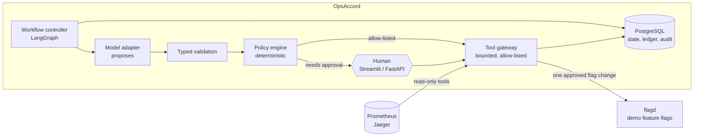

# OpsAccord

An incident-response agent that diagnoses outages from real telemetry and **cannot act on
its own authority**. A language model may propose a fix, but deterministic policy, a typed
tool gateway and an exact human approval decide whether anything runs, and every step is
recorded in PostgreSQL.

It runs against the [OpenTelemetry Astronomy Shop](https://github.com/open-telemetry/opentelemetry-demo),
a microservice demo shop pinned at `3.1.0`, with faults injected through the demo's own
feature flags.


*The Streamlit console: a resolved "Payment unreachable" incident from a simulated run,
with the evidence the agent collected before it proposed anything.*

## Phase 1 results

| Check | Result |
| --- | --- |
| Simulated scenarios (P1-01..P1-09, including two prompt-injection cases) | **9/9 pass** |
| Live paths against the real demo stack (P1-01..P1-07) | **7/7 pass in a single run** |
| Forbidden actions / duplicate side effects / unverified resolutions | **0 / 0 / 0** |
| Tests | 406 offline + 85 PostgreSQL integration, in CI |

What the scenarios cover:

- **Payment unreachable**: the agent gathers metrics and traces, diagnoses the failing
  dependency, asks a human to approve one exact action, runs it once, and verifies recovery
  with fresh evidence.
- **Ad service high CPU**: a low-risk, allow-listed fix that runs without approval and is
  still verified.
- **Cart failure**: no permitted fix exists, so the agent hands off to a human with its
  evidence and suggested next checks.
- **Metrics timeout**: telemetry is unavailable, so the agent escalates instead of acting
  on a health check alone.
- **Rejected approval, an action that times out after dispatch, and a fix that "succeeds"
  while the service stays down**: none of them ends in a duplicate action or a false
  "resolved".
- **Prompt injection in runbook text**: a proposed shell command, and a fix aimed at a
  service it may not touch, are both refused before policy is even consulted.

The one-page [Phase 1 summary](docs/reports/phase1-summary.md) explains what was proven and
how. The full [implementation report](docs/reports/phase1-implementation.md) is the
forensic record behind it.

## How it works



- **The model never decides.** Its output is a proposal. Typed validation rejects
  malformed or unregistered tools, the policy engine applies allow-lists, constraints and
  approval requirements, and only the gateway calls anything.
- **Approvals are exact.** An approval is bound to one action, target, argument digest,
  actor and expiry. It is consumed atomically with the execution claim, so it cannot be
  reused or raced.
- **Uncertainty is never treated as failure.** If dispatch times out, the action stays
  *unknown* until reconciliation finds the outcome, so a fix is never blindly repeated.
- **"Resolved" requires fresh evidence.** Verification reads the path the incident was
  diagnosed on. "No traffic" is neither "broken" nor "fixed"; it is inconclusive and hands
  off.
- **Everything is recorded.** Incidents, evidence, tool calls, decisions, approvals and
  actions are persisted, with an append-only audit trail and durable checkpoints, so a
  restart at any point cannot repeat a side effect.


The full contract is in [docs/architecture.md](docs/architecture.md).

## Run it

Requirements: Linux or WSL 2, Python 3.12 with [uv](https://docs.astral.sh/uv/), and a
local PostgreSQL (the project script runs one on port 55432). The live paths also need
Docker and a checkout of the demo at tag `3.1.0`.

```bash
uv sync --all-groups
scripts/pg.sh start
uv run python -m opsaccord.cli init-db
uv run python -m opsaccord.cli run-scenarios          # the nine simulated scenarios
uv run python -m opsaccord.cli serve-api              # http://127.0.0.1:8410
uv run python -m opsaccord.cli serve-ui               # http://127.0.0.1:8511
scripts/validate.sh                                   # every gate except the live paths
```

The live demo setup is in [docs/development.md](docs/development.md) and
[docs/astronomy-shop.md](docs/astronomy-shop.md).

## Project status and decisions

Phase 1 is merged and tagged `phase1`. Phase 2 starts by putting a real language model in
the loop on the same scenarios, to measure what it proposes and what policy blocks.
[story.md](story.md) records every decision and the reasoning behind it.

The application runs a deterministic reasoning adapter by default. The OpenAI-compatible
adapter is disabled unless paid calls are explicitly enabled with a budget. Nothing here
touches a real payment system or production infrastructure.

## Read next

- [The story so far: decisions and why](story.md)
- [Phase 1 summary](docs/reports/phase1-summary.md)
- [Architecture and safety contract](docs/architecture.md)
- [Phase 1 acceptance criteria](docs/phase1.md)
- [Evaluation roadmap](docs/evaluation.md)
- [Development setup (WSL)](docs/development.md)
- [Astronomy Shop revision, faults and calibration](docs/astronomy-shop.md)
- [Phase 1 implementation report](docs/reports/phase1-implementation.md)

## License

[MIT](LICENSE)
